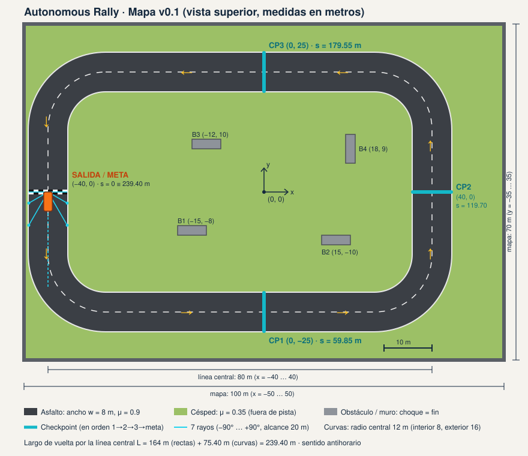

# Ambiente v0.1 — Autonomous Rally · Circuito Mónaco

> Equipo: _______ · Versión del ambiente **0.2** (circuito Mónaco + sensor de agarre) · 28 oct 2026
> Mapa: [mapa-ambiente-v0.1.svg](mapa-ambiente-v0.1.svg), generado desde el código con `rally mapa --svg`.
> Ficha original del curso: [ficha-autonomous-rally.png](ficha-autonomous-rally.png)

**Historial de versiones** (cada una recuperable desde git):

| Versión | Cambios | Dónde |
|---|---|---|
| Pista rectangular | Pista de 239 m, 3 checkpoints | etiqueta `ambiente-v0.1` |
| 0.1-monaco | Circuito de Mónaco, muros, notas del copiloto (16 observaciones). Modelo entrenado: `modelo-v1` | etiqueta `modelo-v1` |
| **0.2** | Sensor de agarre (19 observaciones); correcciones de una revisión de código: estancarse cuesta −50, la puerta cruzada pisando el escape cuenta al volver, círculo de fricción con la velocidad nueva, contorno del carro cada 0.5 m | esta ficha |

## Mision y mapa

**Misión:** dar una vuelta completa al circuito pasando los 6 checkpoints **en orden** y cruzar la meta,
sin chocar contra el muro ni salirse de la pista, en el menor tiempo posible.

**Geometría (vista superior, 2D, metros, origen en el centro del mapa, eje y hacia arriba):**

| Elemento | Definición |
|---|---|
| Trazado | 18 vértices con un radio de curva cada uno. Entre vértices hay rectas y en cada vértice un arco tangente a ambas rectas (así se diseñan los circuitos) |
| Largo de vuelta | **1 048.6 m** por la línea central, en sentido antihorario |
| Ancho de pista | w = 8 m |
| Zona de escape | 2 m a cada lado del borde, con adherencia baja |
| Muro (Armco) | A w/2 + 2 = 6 m del centro, a ambos lados. Tocarlo es choque |
| Mapa | 412.6 × 245.5 m (x en [−206.3, 206.3], y en [−122.8, 122.8]) |
| Salida / Meta | (42.8, −97.8), en la recta Anthony Noghes → Sainte Dévote, mirando al este (ψ = 0) |
| Carro | Largo 4.0 m, ancho 1.8 m, distancia entre ejes 2.5 m, modelo cinemático de bicicleta |

**Curvas** (velocidad máxima teórica: v = √(μ·g·r)):

| Curva | Radio | Giro | v máx. seco (μ = 0.9) | v máx. mojado (μ = 0.5) |
|---|---|---|---|---|
| Anthony Noghes | 16 m | +49° | 11.9 m/s | 8.9 m/s |
| Sainte Dévote | 13 m | +79° | 10.7 m/s | 8.0 m/s |
| Beau Rivage | 90 m | +31° | 28.2 m/s | 21.0 m/s |
| Massenet | 38 m | +76° | 18.3 m/s | 13.7 m/s |
| Casino | 28 m | −39° | 15.7 m/s | 11.7 m/s |
| Casino salida | 24 m | +37° | 14.6 m/s | 10.8 m/s |
| Mirabeau Haute | 13 m | +90° | 10.7 m/s | 8.0 m/s |
| **Fairmont (horquilla)** | **9.5 m** | **−93°** | **9.2 m/s** | **6.8 m/s** |
| **Fairmont salida** | **9.5 m** | **−90°** | **9.2 m/s** | **6.8 m/s** |
| Mirabeau Bas | 12 m | +87° | 10.3 m/s | 7.7 m/s |
| Portier | 14 m | +15° | 11.1 m/s | 8.3 m/s |
| Túnel | 120 m | +57° | 32.5 m/s | 24.3 m/s |
| Nouvelle Chicane | 11 m | +77° | 9.9 m/s | 7.3 m/s |
| Nouvelle Chicane salida | 11 m | −72° | 9.9 m/s | 7.3 m/s |
| Tabac | 15 m | +114° | 11.5 m/s | 8.6 m/s |
| Piscine | 13 m | −46° | 10.7 m/s | 8.0 m/s |
| Piscine salida | 13 m | +53° | 10.7 m/s | 8.0 m/s |
| Rascasse | 10 m | −65° | 9.4 m/s | 7.0 m/s |

La suma de los giros es exactamente 360°: el trazado da una sola vuelta y no se cruza. Las pruebas
automáticas lo verifican, junto con que dos tramos no vecinos nunca queden a menos de 18 m.

**Checkpoints** (puertas a 12 m de la salida de su curva):

| Puerta | Ubicación | s (m) |
|---|---|---|
| CP1 | Después de Beau Rivage | 251.9 |
| CP2 | Después de la salida del Casino | 413.7 |
| CP3 | Después de la horquilla de Fairmont | 556.0 |
| CP4 | Final del túnel | 768.1 |
| CP5 | Después de la Nouvelle Chicane | 811.2 |
| CP6 | Después de la Piscine | 913.8 |
| Meta | Línea de salida | 1 048.6 |

## Variables y unidades

### Parámetros del escenario

| Parámetro | Símbolo | Unidad | Base | Rango | Justificación | ¿Lo ve el agente? |
|---|---|---|---|---|---|---|
| Ancho de pista | w | m | 8 | [6, 12] | El carro mide 1.8 m. Mónaco es angosto: con 6 m quedan 2 m por lado | Indirectamente (rayos) |
| Adherencia del asfalto | μ | coeficiente | 0.9 | [0.4, 1.0] | 0.9 ≈ asfalto seco y 0.5 ≈ mojado | No |
| Adherencia del escape | μ_e | coeficiente | 0.35 | fija | Fuera del asfalto se agarra mucho menos | No |
| Aceleración máxima | a_max | m/s² | 4 | [2, 6] | 0→100 km/h en ~7 s | No |
| Frenado máximo | b_max | m/s² | 8 | fijo | Frenada fuerte en seco | No |
| Alcance de sensores | r_max | m | 20 | [10, 40] | Para frenar de 20 a 9 m/s antes de la horquilla hacen falta ~20 m | Indirectamente (rayos) |
| Velocidad máxima | v_max | m/s | 25 | fija | 90 km/h | No |
| Dirección máxima | δ_max | ° | 30 | fija | Ángulo típico de las ruedas delanteras | No |
| Paso de tiempo | dt | s | 0.1 | fijo | 10 Hz | No |
| Resistencia | k | 1/s | 0.05 | fija | El carro pierde velocidad si no acelera | No |

### Estado del mundo

| Variable | Significado | Unidad | Rango | ¿Lo ve el agente? |
|---|---|---|---|---|
| x, y | Posición del centro del carro | m | mapa | No |
| ψ | Orientación (0 = este, antihorario positivo) | rad | [−π, π) | No (solo el error respecto a la pista) |
| v | Velocidad hacia adelante | m/s | [0, 25] | Sí |
| ω | Velocidad de giro | rad/s | [−2, 2] | Sí |
| s | Progreso acumulado sobre la línea central (negativo si arranca detrás de la línea; pasa de 1 048.6 al cruzar la meta) | m | [−1, ~1 052] | No |
| s_best | Máximo progreso válido alcanzado | m | [0, 1 048.6] | No |
| d | Desvío lateral del centro (+ = izquierda) | m | [−6, 6] | Sí (normalizado) |
| next_cp | Siguiente puerta que hay que cruzar (8 = vuelta terminada) | entero | {1…8} | Indirectamente (dirección) |
| t | Tiempo del episodio | s | [0, 180] | No |
| t_fuera | Tiempo seguido fuera del asfalto | s | [0, 1.0] | No |
| uso de agarre | Aceleración de las llantas / (μ·g) | — | [0, 1] | Sí |
| derrape | Si las llantas están en su límite en este paso | bool | {0, 1} | Sí |
| μ estimado | Menor agarre medido en el episodio (empieza en 1.2 = sin medir) | — | [0, 1.2] | Sí |

## Observaciones y acciones

### Observación (vector de 19 valores normalizados)

| # | Componente | Cálculo | Rango |
|---|---|---|---|
| 0 | Velocidad | v / v_max | [0, 1] |
| 1 | Giro | clip(ω / 2, −1, 1) | [−1, 1] |
| 2–3 | Dirección al siguiente checkpoint | sin φ, cos φ (φ = ángulo entre el rumbo y la puerta) | [−1, 1] |
| 4 | Desvío del centro | clip(d / (w/2), −2, 2) | [−2, 2] |
| 5 | Error de rumbo respecto a la pista | e_ψ / π | [−1, 1] |
| 6–12 | 7 rayos a −90°, −60°, −30°, 0°, +30°, +60° y +90° | distancia al borde de pista o al muro / r_max | [0, 1] |
| 13–15 | **Notas del copiloto** | curvatura de la pista a 10, 25 y 50 m adelante × 9.5 m (+ izquierda, − derecha) | [−1, 1] |
| 16 | **Uso de agarre** | aceleración de las llantas / (μ·g), recortado a 1 | [0, 1] |
| 17 | **Derrape** | 1 si las llantas están en su límite en este paso | {0, 1} |
| 18 | **Agarre estimado** | menor μ medido en el episodio / 1.2 | [0, 1] |

**Notas del copiloto:** en el rally real el copiloto le lee al piloto las curvas que vienen ("derecha
cerrada en 50"). Sin ellas, con rayos de 20 m, el agente no puede saber a tiempo que viene la horquilla.

**Sensor de agarre (v0.2):** el modelo v1 chocaba con lluvia en Sainte Dévote porque no tenía forma de
saber que el piso estaba mojado. El agente sigue **sin ver μ directamente**, pero ahora tiene lo que mide
un control de tracción real. Cuando las llantas llegan a su límite (al frenar o al girar fuerte), el
simulador mide el agarre disponible y lo guarda como "agarre estimado". Por ejemplo, en mojado una
frenada fuerte satura las llantas (8 m/s² > 0.5·g) y revela μ ≈ 0.5; en seco no se satura (8 < 0.9·g)
y el estimado sigue en "sin medir". Así el agente puede aprender a "probar los frenos" en la recta.

### Acción (continua, 2 controles)

| Control | Rango | Significado |
|---|---|---|
| u_acel | [−1, 1] | Valores positivos aceleran (u·a_max); valores negativos frenan (u·b_max). No hay reversa: v ≥ 0 |
| u_dir | [−1, 1] | Ángulo de ruedas δ = u_dir · δ_max (+ = izquierda) |

Para Q-learning con tabla, las acciones se vuelven discretas: 3 de pedal × 5 de dirección = 15 acciones.

## Dinamica

En cada paso (dt = 0.1 s), el simulador aplica estas reglas en orden:

1. Recorta las acciones a [−1, 1] y calcula δ = u_dir · 30°.
2. Elige la adherencia: μ en el asfalto (|d| ≤ w/2) o μ_e = 0.35 en la zona de escape.
3. Calcula la fuerza de las llantas: `u_acel·a_max` o `u_acel·b_max`, recortada a μ·g. Luego resta la
   resistencia `k·v` (no es fuerza de las llantas, así que no gasta agarre) y obtiene la velocidad nueva v'.
4. Aplica el **círculo de fricción** con la velocidad nueva v' (la misma con la que se integra el giro):
   la aceleración de las llantas no puede pasar μ·g. Si la curva pide más aceleración lateral de la
   disponible, el carro **subvira** (gira menos de lo ordenado y se abre). Si las llantas llegan a su
   límite, se marca derrape y se actualiza el agarre estimado.
5. Integra la bicicleta cinemática: ψ, x, y.
6. Proyecta la posición sobre la línea central (KD-tree sobre muestras cada 0.25 m) para obtener s y d.
   Un salto de s mayor que lo que se puede recorrer en un paso se ignora: es una proyección sobre otro
   tramo cercano, como en la horquilla.
7. Aplica las reglas:
   - **Checkpoint:** cuenta cuando el carro está en el asfalto y ya pasó la puerta de `next_cp` hace
     menos de 30 m (lo que se recorre en el segundo máximo fuera de pista). Así, si cruzó la puerta
     pisando el escape, cuenta al volver al asfalto; pero aparecer mucho más adelante es un atajo y no cuenta.
   - **Progreso:** se paga el nuevo máximo de s, pero **nunca más de lo que el carro avanzó en ese paso**
     ni más allá de la próxima puerta sin cruzarla.
   - **Choque:** si algún punto del contorno del carro (muestreado cada ~0.5 m) pasa el muro
     (|d| > w/2 + 2 m).
   - **Fuera de pista:** si el centro del carro sale del asfalto, suma tiempo fuera.

## Recompensa

`r = r_prog + r_cp + r_vuelta + r_tiempo + r_fuera + r_suave + r_fin`

| Término | Valor | Cuándo |
|---|---|---|
| r_prog | +0.1 por metro de avance válido | En el asfalto, solo el avance real del paso |
| r_cp | +10 | Al cruzar el checkpoint que toca (CP1 a CP6), una vez |
| r_vuelta | +50 | Al cruzar la meta después de CP6 |
| r_tiempo | −0.05 por paso | Siempre |
| r_fuera | −1.0 por paso | Mientras el centro del carro está fuera del asfalto |
| r_suave | −0.2·\|Δu_dir\| − 0.05·\|Δu_acel\| | Penaliza los cambios bruscos de mando |
| r_fin | −50 | Al chocar, al salir del asfalto por ≥ 1 s o al quedar estancado 10 s |

**Escala:** una vuelta limpia en ~78 s da ≈ +105 (progreso) + 60 (CP) + 50 (vuelta) − 39 (tiempo) −
(suavidad) ≈ **+170**. El piloto experto obtiene +169.6 en seco.

## Exito, fracaso y limite de tiempo

| Resultado | Condición | Tipo de fin |
|---|---|---|
| **Éxito** | Cruzar CP1 a CP6 y la meta en orden, en el asfalto | `terminated` |
| **Choque** | El contorno del carro toca el muro | `terminated`, −50 |
| **Salida de pista** | 10 pasos seguidos (1 s) con el centro fuera del asfalto | `terminated`, −50 |
| **Estancado** | s_best no mejora en 10 s | `terminated`, −50 |
| **Límite de tiempo** | t = 180 s (1 800 pasos), unas 2.3 veces la vuelta experta | `truncated` |

**Estado inicial:** en la línea de salida, desvío lateral U(−0.5, 0.5) m, rumbo ±U(−5°, 5°), v = 0.

## Metricas e incidente

**Protocolo:** 100 episodios con semillas fijas (0–99), política en modo determinista. Las semillas de
entrenamiento son distintas (Q-learning desde 100 000, PPO desde 200 000, dataset desde 500), así el
modelo nunca se evalúa en los mismos arranques con los que entrenó.

**Resultados del modelo v1** (`modelo-v1`, 1 millón de pasos):

| Piloto | Seco: vueltas | Seco: tiempo | Mojado: vueltas | Mojado: avance |
|---|---|---|---|---|
| PPO (red neuronal) | 100 % | 77.6 s | 0 % | 57.6 % |
| Q-learning (tabla) | 0 % | — | 0 % | 11.9 % |

**Resultados del modelo v2** (`modelo-v2`, ambiente 0.2 con sensor de agarre, 3 millones de pasos):

| Piloto | Seco: vueltas | Seco: tiempo | Mojado: vueltas | Mojado: avance |
|---|---|---|---|---|
| PPO (red neuronal) | 100 % | **63.1 s** (−18.5 %) | 0 % | 11.6 % |
| Q-learning (tabla) | 0 % (21.7 % de avance) | — | 0 % | 11.7 % |

Lectura: en seco la v2 es mucho más rápida que la v1 y que el piloto experto. Con lluvia empeoró:
el modelo aprendió a ir más agresivo y el sensor de agarre no bastó para que frene antes. El
protocolo de la ficha no acepta la v2 (no mejora en mojado). Próximo experimento sugerido: entrenar
con más episodios de lluvia (rango de μ sesgado a 0.5) o penalizar más los choques.

| # | Métrica | Definición |
|---|---|---|
| 1 | **Tasa de vueltas completas** | % de episodios que terminan en éxito |
| 2 | **Tiempo de vuelta** | Mediana y p90 (s) de los episodios exitosos |
| 3 | **Incidentes por episodio** | Promedio de (salidas de pista + choques) |

**Incidente:** asfalto mojado, μ de 0.9 a **0.5**, sin cambiar nada más. El candidato se acepta si:
- en mojado completa más vueltas que el modelo base, y
- en seco no pierde más de 5 puntos porcentuales de vueltas ni sube más de 5 % su tiempo mediano.

Referencia con los pilotos de base (`rally evaluar`):

| Piloto | Seco | Mojado |
|---|---|---|
| Experto (asume μ = 0.9) | 100 % · 77.5 s | 0 % (choca) |
| Prudente (asume μ = 0.5) | 100 % · 96.7 s | 100 % · 96.8 s |

## Cinco transiciones

Calculadas por el ambiente y verificadas por `rally transiciones` y las pruebas automáticas.
Parámetros base: w = 8, μ = 0.9, a_max = 4, b_max = 8, dt = 0.1.

| | Escenario | Estado inicial | Acción | Resultado | Recompensa |
|---|---|---|---|---|---|
| T1 | Arranque en la salida | s = 0, v = 0 | (+1, 0) | v' = 0.40 m/s, avanza 0.04 m | **−0.096** |
| T2 | Cruce del CP1 | 1 m antes del CP1, v = 20 | (+0.3, 0) | Avanza 2.00 m, cruza CP1 → next_cp = 2 | **+10.150** |
| T3 | Horquilla de Fairmont rápido | Entrada de Fairmont, v = 15 | (0, −1) | Pide más agarre del que hay: **derrapa** (subviraje) | **−0.101** |
| T4 | Choque contra el muro | s = 100, d = +4.5, rumbo +25°, v = 12 | (+0.5, 0) | El contorno pasa el muro → **choque** | **−51.050** |
| T5 | Llegada a la meta | 1 m antes de la meta, next_cp = 7 | (+1, 0) | Cruza la meta → **éxito** | **+50.040** |

**T1 a mano:** a_long = 1·4 − 0.05·0 = 4 → v' = 0.4 m/s → avanza 0.04 m.
Recompensa = 0.1·0.04 (progreso) − 0.05 (tiempo) − 0.05·|1 − 0| (cambio de pedal) = **−0.096**.

**T2 a mano:** a_long = 0.3·4 − 0.05·20 = 0.2 → v' = 20.02 → avanza 2.002 m.
Recompensa = 0.1·2.002 + 10 (CP1) − 0.05 = **+10.150**.

## Posibles trampas y decisiones pendientes

| Trampa | Cómo la evitamos | Prueba automática |
|---|---|---|
| Pasar dos veces por el mismo checkpoint | Solo cuenta `next_cp`, que nunca retrocede | `test_checkpoint_no_paga_dos_veces` |
| Ir y volver para cobrar progreso | Se paga sobre el máximo alcanzado (s_best) | `test_ir_y_volver_no_acumula` |
| Atajo: llegar a una puerta posterior sin pasar las anteriores | Progreso topado en la próxima puerta y solo por el avance real del paso. **Esta trampa la encontraron las pruebas en esta versión** y se corrigió | `test_atajo_no_paga` |
| Saltar de un tramo a otro cercano (horquilla) | Los saltos de s imposibles en un paso no cuentan | `test_salto_de_proyeccion_no_es_avance` |
| Quedarse quieto para no arriesgar | Estancarse 10 s termina el episodio con −50, igual que chocar. **En v0.1 costaba solo −5 y el Q-learning v1 aprendió a detenerse antes de la parte difícil**; lo encontró una revisión de código | `test_estancarse_no_es_salida_barata` |
| Cruzar una puerta pisando el escape y perderla | Cuenta al volver al asfalto (si fue hace menos de 30 m) | `test_puerta_cruzada_en_el_escape_cuenta_al_volver` |
| Ir en reversa | No hay reversa (v ≥ 0) | `test_sin_reversa` |

### Decisiones pendientes

1. **"Fuera de pista": ¿centro del carro o carrocería completa?** Hoy se usa el centro.
2. **¿El agente debe ver el tiempo restante?** Sin él, el truncamiento no es markoviano.
3. **Pesos de r_suave:** son tentativos; si el agente se vuelve tímido hay que bajarlos.
4. **Ruido en los rayos** como segunda perturbación.
5. **¿El sensor de agarre es "trampa"?** El agente no ve μ, pero sí una medición que en un carro real
   da el control de tracción. Hay que comparar en MLflow la v1 (sin sensor) con la v2 (con sensor).
6. **Más vueltas o pistas aleatorias** para evitar que el agente memorice el circuito.
